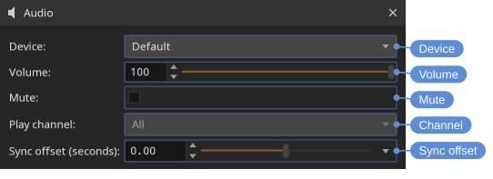

# Audio

DJV plays multi-track audio in sync with video, including during variable-speed and reverse playback. Audio can come from a movie file, or be paired with an image sequence (see [File formats](formats.html#image-sequences-with-audio)).

## Volume and mute

Volume and mute are available from the **Audio** menu, the speaker control in the **Bottom** tool bar (click to show the volume slider and mute button), and the **Audio** tool. The speaker icon changes to show when the audio is muted.

**Audio > Volume Up** (<kbd>.</kbd>), **Audio > Volume Down** (<kbd>,</kbd>), and **Audio > Mute** (<kbd>M</kbd>).

## Audio tool

The **Audio** tool gives fine-grained control over audio output.

Locations: **Tools** menu, **Tools** toolbar

Open it with **Tools > Audio** (<kbd>F8</kbd>).

- **Device** — The audio output device. **Default** uses the system default device.
- **Volume** — Output volume, from 0 to 100.
- **Mute** — Mute all audio output.
- **Channel** — Play all of the channels, or only one. For stereo files the channels are labelled **L** and **R**; files with more channels are numbered. The channel is chosen for each file.
- **Sync offset (seconds)** — Shift the audio earlier or later relative to the video, from -1.0 to 1.0 seconds. Use this to correct material where the audio and video are out of sync.

> [!NOTE]
> When a non-zero sync offset is set, a status bar indicator is shown as a reminder.
