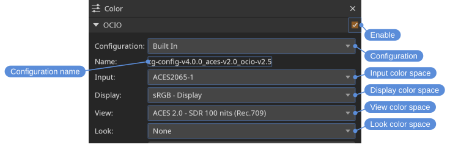
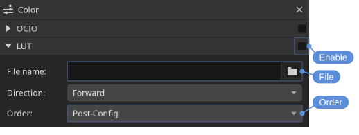
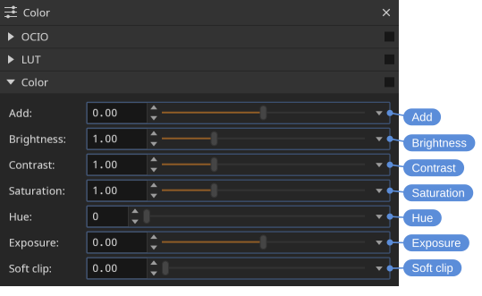
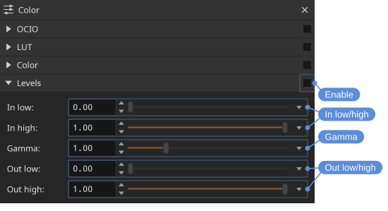

# Color

The **Color** tool covers everything color-related: OpenColorIO settings, LUTs (look-up tables), and image adjustments such as brightness, contrast, levels, and exposure.

Locations: **Tools** menu, **Tools** toolbar

Open it with **Tools > Color** (<kbd>F4</kbd>).

The tool is divided into collapsible sections — **OCIO**, **LUT**, **Color**, and **Levels** — and each can be turned on or off independently using the checkbox in its header. This makes it easy to compare the image with and without a given adjustment.

> [!NOTE]
> When any of the color controls are active, a status bar indicator is shown so the adjustment isn't forgotten about.

**Color > Enable Color** turns all of the sections off at once, to see the image unaltered, and turns the same ones back on again. **Color > Reset Color**, and the **Reset** button at the bottom of the tool, return the sections to their defaults, asking which: the sections that have something to reset are ticked, and the ones already at their defaults are shown but cannot be chosen. The **OCIO** section includes the extension assignments. Neither has a shortcut by default; one can be assigned in the **Settings** tool.

A slider marks its default value with a vertical line. Double click the slider to reset it. The triangle at the end of the slider opens a popup with the reset and the range.

## OpenColorIO (OCIO)

The OpenColorIO configuration can be set to a built-in configuration, the **OCIO** environment variable, or a specific file path. A configuration is shown through its own default **Display** and **View** until others are chosen; the check box in the section header is how OCIO is turned off. When the **OCIO** environment variable is set, DJV starts with OCIO turned on and using it, until a different choice is made in the settings; **Reset Color** returns to it too.

### Input color spaces

The **Input** color space can be named explicitly, or left at **Automatic** and resolved for each file. Resolving takes the first of:

- The extension assignments in the **Color** tool.
- What the file declares — an OpenEXR file's `colorInteropID` attribute or chromaticities, a movie's color description. A declaration the configuration has no color space for ends the resolution: the image is shown unmanaged rather than guessed at, and the resolved display in the **Color** tool says so.
- The configuration's file rules, including its default rule, which matches every path. A configuration without file rules uses its `default` role. To show files differently from what the configuration says, assign a color space to their extension. For example, the built-in configuration takes an OpenEXR file that declares nothing as ACES2065-1; renders that are linear Rec.709 without saying so need an `.exr` assignment.

The **Color** tool shows what was resolved and where it came from, and files being compared are each shown through their own input color space. The clips of a timeline are each resolved from their own media, and the **Color** tool shows **Per clip**; the log records how each file's color was decided, the clips of a timeline included, in the **Messages** tool.

An OTIO timeline resolves per clip rather than as a whole.

**Color > Enable OCIO** (<kbd>Ctrl+N</kbd>) turns the OCIO section on and off.

## LUT

A LUT can be applied either before or after the OpenColorIO pass — set the LUT **Order** option to **PreColorConfig** or **PostColorConfig** as needed.

The **Direction** option applies the LUT forward or inverted. An ICC monitor profile reads from the monitor's code values, so correcting the display with one takes **Inverse**.

**Color > Enable LUT** (<kbd>Ctrl+K</kbd>) turns the LUT section on and off.

### Supported LUT formats

The following LUT formats are supported:

- flame: .3dl
- lustre: .3dl
- ColorCorrection: .cc
- ColorCorrectionCollection: .ccc
- ColorDecisionList: .cdl
- Academy/ASC Common LUT Format: .clf
- Color Transform Format: .ctf
- cinespace: .csp
- Discreet 1D LUT: .lut
- houdini: .lut
- International Color Consortium profile: .icc
- Image Color Matching profile: .icm
- ICC profile: .pf
- iridas_cube: .cube
- iridas_itx: .itx
- iridas_look: .look
- pandora_mga: .mga
- pandora_m3d: .m3d
- resolve_cube: .cube
- spi1d: .spi1d
- spi3d: .spi3d
- spimtx: .spimtx
- truelight: .cub
- nukevf: .vf

Different formats may be available depending on how DJV was built.

## Color

Basic color adjustments:

- **Add** — Add a constant value to each channel.
- **Brightness** — Scale the overall brightness.
- **Contrast** — Increase or decrease contrast around the midpoint.
- **Saturation** — Adjust color intensity, from grayscale up to oversaturated.
- **Hue** — Rotate the hue.
- **Invert** — Invert the image colors.
- **Exposure** — Adjust the image in stops; each stop doubles the brightness, and zero leaves the image unchanged. Stops are stops on linear values: with OCIO on and the input color space set, the image is made linear before the adjustments. Otherwise the values are taken as the file stores them, and for a log encoded image that is not stops; a LUT does not make the values linear.
- **Soft clip** — Roll off values approaching white instead of clipping them hard, which helps preserve detail in bright highlights.

The check box in the header turns all of them on or off. For gamma see [Levels](#levels).

## Levels

Levels remap the input tonal range to an output range, similar to the levels control in an image editor:

- **In low** / **In high** — The black and white points of the input.
- **Gamma** — A midtone adjustment applied between the input and output ranges.
- **Out low** / **Out high** — The black and white points of the output.
