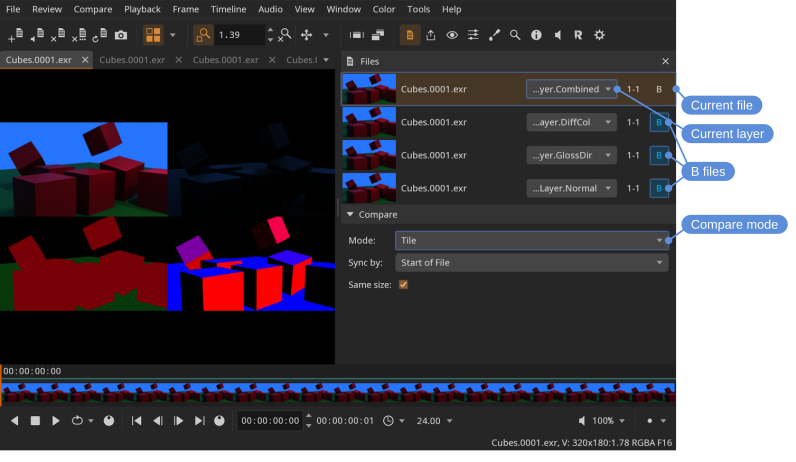

# A/B comparison

A/B comparison lets you view two files (or layers) at once — useful for checking revisions, matching color between shots, or spotting differences between renders.

It is for comparing *pixels*. To compare what two files are — their resolution, format or timing — open them and switch between them with **File > Next** and **File > Previous** instead, which makes each one current in turn. See [Comparing file information](#comparing-file-information).

## Setting up a comparison

1. Open the files in DJV.
2. The current file is the **A** file. Mark one or more of the others as **B** with the **B** button in the **Files** tool, or step through them with **Compare > Next** and **Compare > Previous**.
3. Turn on a compare mode (see below).

Locations: **Compare** menu, **Compare** tool bar, **Files** tool

The tool bar has one button for the modes: it shows the mode chosen last and turns it on and off, and the arrow beside it chooses another.

**Compare > Next** (<kbd>Shift+Page Down</kbd>) and **Compare > Previous** (<kbd>Shift+Page Up</kbd>) change the B file to the next or previous one in the file list.

> [!NOTE]
> Drag with **Alt** + left mouse button to move the wipe between **A** and **B**.

## Compare modes

The modes are toggles rather than a list to choose from: turning one on turns off any other, and turning it off again leaves the **A** file on its own. There is no separate mode for showing **A** — that is what no comparison looks like.

| Mode | What it shows | Shortcut |
|---|---|---|
| **B** | Only the **B** file | <kbd>Ctrl+B</kbd> |
| **Wipe** | A wipe between **A** and **B** (drag with **Alt** + left mouse button) | <kbd>Ctrl+W</kbd> |
| **Butterfly** | The same half of **A** and **B**, one mirrored, meeting in the middle |  |
| **Overlay** | **B** layered on top of **A** |  |
| **Difference** | The pixel difference between **A** and **B** |  |
| **Horizontal** | **A** and **B** side by side |  |
| **Vertical** | **A** above **B** |  |
| **Tile** | **A** and **B** as tiles (supports multiple **B** files) | <kbd>Ctrl+T</kbd> |

The modes without a shortcut can be given one in the **Keyboard Shortcuts** section of the **Settings** tool.

## Butterfly

**Butterfly** shows the left half of **A** beside the left half of **B** mirrored, so the two meet in the middle of the picture on the same subject. Side by side puts different parts of the frame next to each other, which is fine for checking a change happened and poor for judging one: a colour reads differently against different surroundings. Butterfly puts the same thing next to itself, which is what comparing a grade with its original wants.

The seam is the middle of the frame, so what ends up either side of it is the middle of the picture, and the outer edges are both the left edge.

## Difference gain

**Difference** shows how far apart the two files are at each pixel, and the differences worth looking for are often very small — a compressed version differs from its source by a code value or two, which is not distinguishable from black. **Gain** multiplies the difference so that it can be seen; at 16 a difference of one code value in eight bits reads as a clear grey.

The brightness is the size of the difference and the colour is which channels it is in, so a gain high enough to make the small differences visible drives the large ones to white. Work down from a high gain to find where something differs, then back off to judge by how much.

## Same size

Files of different resolutions are drawn at the size of the current file, so a smaller one is not shown tiny beside it. Turn **Same size** off to draw each file at its own size.

This is what the view is describing while it is on. With a 1920x1080 **A** and a 1280x720 **B**, the frame really is 1920x1080 whichever file is on screen, and the **View Zoom** and **Render** items in the HUD report that frame rather than either file.

Locations: **Files** tool

## Sync by

Which frame of each file is shown together:

- **Start of File** — The **B** file is offset so its start aligns with the start of **A**.
- **Timecode** — **A** and **B** play at the same timeline time.

Files that start at different timecodes show black in **B** until this is set to **Start of File**.

A still, one frame long, is shown as **B** at every frame of **A**.

Locations: **Compare** menu, **Files** tool

## Comparing against a held frame {#held-frame}

**Compare > Hold Frame** (<kbd>Shift+H</kbd>) keeps the current frame and makes it **B**: it stays put while you play, scrub, or open another file, and every compare mode works with it. It is for a frame against another frame of the same clip, or a still against a movie: hold the still, then go to the movie. A wipe is used if no compare mode is chosen.

While it is **B**, the status bar indicator is lit, so the held frame is not taken for **B** at the current time, and the Files tool's Compare section shows the file and the time it was held from, with a button to let it go. The color settings apply to it as they do to **A**, and exports and **File > Export Still** show it as the view does. Drawings are not made on it or shown over it.

To see **A** alone, set the compare mode to none: the frame stays held, and is **B** again with the next mode chosen. **Compare > Hold Frame** again holds the frame then current, and **Compare > Clear Held Frame** (<kbd>Alt+Shift+H</kbd>) lets it go, back to the **B** files. It is not kept when DJV closes.

Locations: **Compare** menu, **Files** tool

## Comparing multiple layers

Tile mode supports multiple **B** files, which makes it handy for viewing several layers of a single file at once. Open the file multiple times and set a different active layer for each instance, then enable **Tile** compare mode and add the other instances as **B** files.

1. Set the compare mode to **Tile**
2. Set the current file and its layer
3. Add the **B** files and pick a layer for each

## Comparing file information

The **Information** tool and the HUD describe the **A** file — the current one — whatever a comparison is showing. A comparison changes which pixels are drawn, not which file is current, so switching between **B** and a wipe does not change what they report.

Drawings from the **Review** tool follow the same rule where the files are drawn over each other: **Wipe**, **Butterfly**, **Overlay**, and **Difference** show and take the drawings of **A**. The drawings of **B** show in **B**, **Horizontal**, **Vertical**, and **Tile**.

To compare what two files are rather than how they look, open them and switch between them with **File > Next** and **File > Previous** (<kbd>Ctrl+Page Down</kbd> and <kbd>Ctrl+Page Up</kbd>), or click their tabs. Each becomes the current file in turn, and every display follows it.
