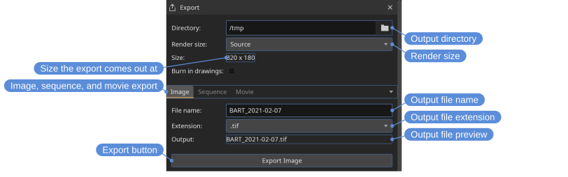
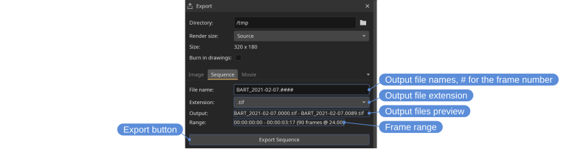
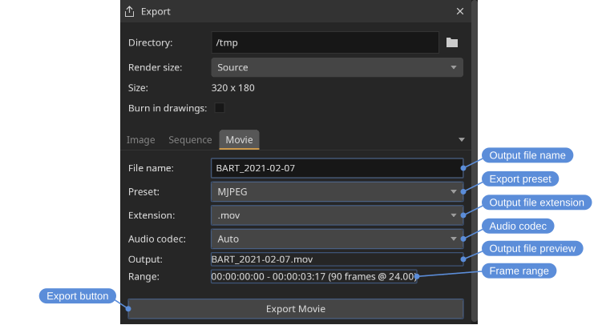

# Exporting files

The **Export** tool writes out the current file as a single still image, a numbered image sequence, or a movie. Each kind of export has its own tab with its own options and export button.

Locations: **Tools** menu, **Tools** toolbar

Shortcut: <kbd>F2</kbd>

- Render size — **Default** for the size of what is being exported with no scaling; one of the preset widths, or **Width** for a width typed in, where the height follows the aspect ratio of what is being exported so nothing is squashed to fit; or **Custom** for a width and height typed in, used as they are. A height that follows from a width is rounded to an even number for a movie, which its codecs need; the source's own size and a custom size are used as they are, and the export says if the codec cannot take them.
- Size — The size the export comes out at, with the edits for what can be typed.
- Burn in drawings — Write the review drawings into the picture, on the frames they are on (see [Review](reviews.html)).
- File name — The name of the file to write, without its extension. A run of `#` is replaced by the frame number, as many digits wide as there are `#`: `render.####` writes `render.0023.exr`. Digits are part of the name. A name typed with one of the extensions on it takes that extension.
- Extension — The file format to write.
- Output — The name that will be written, or what is wrong with the file name. Exporting over a file that is already there asks first, so nothing is overwritten without saying so.

## Image

The **Image** tab exports just the current frame as a single still image. A file name without `#` has no frame number; with one, the number follows the playhead.

## Export Still {#still}

**Export Still** writes the current frame in one step, without the Export tool: as the viewport shows it, with the files being compared, the color, and the drawings when **Burn in drawings** is on, at the size the sources are shown at. It goes into the Export tool's directory in the format of its **Image** tab, named after the file and the time as the time units show it: `Train-Shaded_01-00-00-03.tif`. A still of the same frame is written over.

Locations: **File** menu, **File** toolbar

Shortcut: <kbd>Ctrl+Shift+S</kbd>

## Sequence

The **Sequence** tab exports the in/out range as a numbered image sequence. The file name needs a `#` where the frame number goes; `render.####` with `.exr` gives `render.0001.exr`. The **Output** preview shows the first and last files of the sequence. Exporting asks first if any frame of the range is already on disk.

## Movie

The **Movie** tab exports the in/out range as a movie file. The **Preset** chooses the output: MJPEG, ProRes 422 and 4444, APV 422 and 444, FFV1, CineForm, AV1, and GIF are encoded by DJV, where the build has the encoder — the menu lists only the presets it can write, so a package without a ProRes encoder offers no ProRes — and the presets marked *ffmpeg command* are encoded by the FFmpeg command line application installed on the system, which provides H.264, HEVC, and VP9. Where to find the external FFmpeg is set in the [settings](settings.html); the command presets write video only.

The **GIF** preset is for where a movie cannot go: reference boards, design tools, chat. A GIF holds 256 colors a frame, so the colors are chosen from the picture and the rest is dithered; it has no audio, its frame rate is rounded to hundredths of a second, and it is large for what it shows, so a smaller **Render width** and a short range suit it best.

The **Extension** lists the file types the chosen preset is written to — CineForm to **.mov**, AV1 to **.mp4** or **.mkv**, FFV1 to **.mkv** first of all, GIF to **.gif**, and so on — and changes with the preset. A preset and a file type that do not go together is not a combination the export can make; where one is asked for from a script it is reported rather than quietly changed.

If the source has audio it is included in the movie, except with the *ffmpeg command* presets — H.264, HEVC, and VP9 — which write video only, so the movie they write has no audio whatever the source had, and with GIF, which has nowhere to put it. The **Audio codec** defaults to **Auto**, which lets the file format choose, or a specific codec can be selected; it is disabled when the source has no audio, or when the preset writes video only, and what the export will do with the audio is written under it either way.

Available extensions depend on how DJV was built, and the **Extension** menu lists them. Image and sequence exports typically support `.exr`, `.png`, `.tif`, and `.tiff`; movie exports typically support `.mov`, `.mp4`, `.mkv`, and `.m4v`.

Exports respect the current layer, playback speed, in/out range, and color settings. A comparison is exported the way the viewport shows it: a side by side comparison of two files writes both of them, at the size the comparison comes to, and the **Source** render width follows that rather than the A file on its own.

The file that is written carries a color description: the display's when the export is color managed, the source's when it is not.
