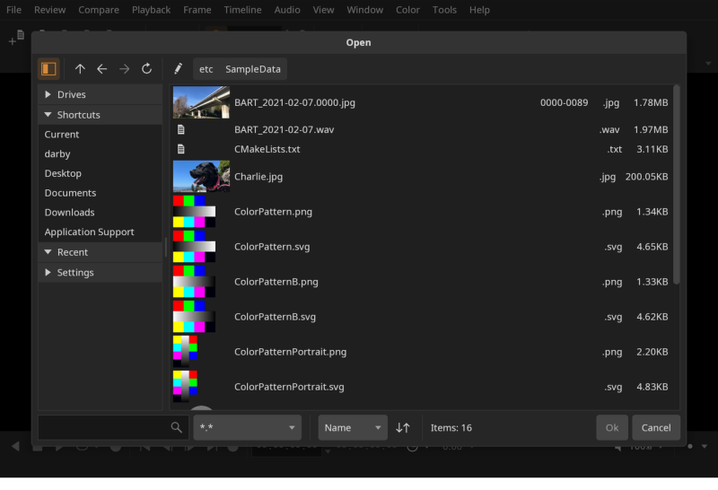
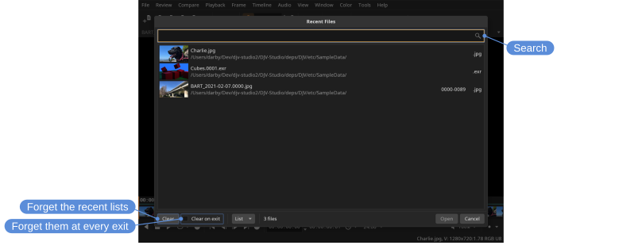
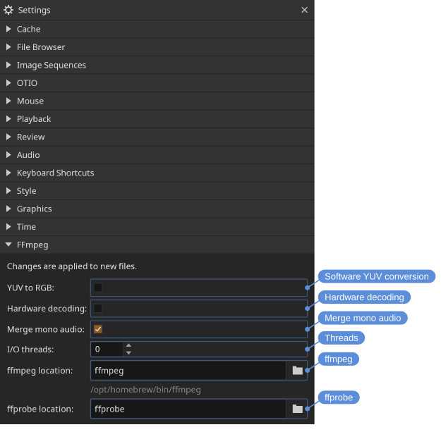
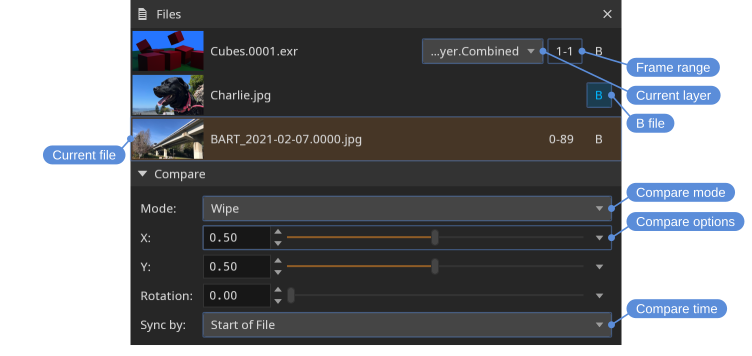

# Files

DJV ships with support for the following formats:

- Image sequences: Cineon, DPX, JPEG, OpenEXR, PNG, PPM, Radiance HDR, SGI, TGA, BMP, TIFF
- Movie codecs: MJPEG, MPEG-2, MPEG-4, AV1, APV, CineForm, GIF
- Audio codecs: FLAC, MP3, WAV
- Timelines: OTIO, OTIOZ
- Experimental: USD

Different formats may be available depending on how DJV was built, or by using an external FFmpeg command.

> [!NOTE]
> These are the formats DJV reads. For the formats DJV writes, see [Exporting files](export.html).

## Opening files

You can open files and folders in three ways:

- From the **File** menu or **File** tool bar
- By dragging and dropping onto the main window
- From the command line

Opening a folder opens every supported file in that folder. From the command line, **-dirFilter** filters the files by name — a case-insensitive substring, or a wildcard pattern with "*" and "?" — and **-dirDepth** opens that many folder levels, the default being one, the folder alone. So a whole shot tree opens as one file list:

```
djv shots -dirFilter "*latest*" -dirDepth 3
```

The files keep a fixed order, grouped by folder. Folder links are listed but not followed. The options hold for the whole session, folders opened from the dialogs included.

Shortcuts:

- Open: <kbd>Ctrl+O</kbd>
- Open with audio: <kbd>Ctrl+Shift+O</kbd>
- Recent files: <kbd>Ctrl+Shift+R</kbd>
- Reload: <kbd>Ctrl+R</kbd>
- Close: <kbd>Ctrl+E</kbd>
- Close all: <kbd>Ctrl+Shift+E</kbd>
- Export still: <kbd>Ctrl+Shift+S</kbd> (see [Export Still](export.html#still))

Image sequences can be opened from the command line by either specifying the first frame or using the "#" wildcard. For example:

```
djv render.#.exr
```

The native file browser is enabled by default on Windows and macOS. To use DJV's built-in file browser instead, change the option in the **Settings** tool. Linux packages are built without the native file browser, since it would mean linking to the desktop's own; there the built-in browser is always used and the option is disabled.

### The built-in file browser

The built-in file browser has a panel on the left for navigation and a file list on the right:

- **Drives** — Mounted drives and volumes.
- **Shortcuts** — Common locations such as the home, Desktop, Documents, and Downloads folders.
- **Recent** — Recently visited directories.
- **Settings** — Whether the files are shown as a list with their details or as tiles of larger thumbnails, the size of the thumbnails, whether image sequences are gathered into one item, and whether hidden files are shown.

Above the file list are buttons to go up a directory, navigate back and forward, reload, and edit the current path, along with a row of *path buttons* for quickly jumping to any parent directory. Below the list, a search box filters by name, an extension menu filters by file type, and the sort menu and direction button order the results.

Image sequences are shown as a single item with their frame range, so a multi-thousand-frame render appears as one entry rather than thousands.



The file list can be driven from the keyboard: the arrow keys move through it, and <kbd>Return</kbd> opens the selection or enters a directory. When saving, a file name is suggested, and <kbd>Return</kbd> in the name accepts it.

### Floating the file browser

The file browser normally opens over the main window, which covers whatever is playing while you choose. Turn on **Floating window** in the **Settings** tool to open it in a window of its own instead, so the media stays visible. The setting takes effect the next time the browser is opened.

A floating browser closes when a file is chosen, the same as the dialog. Check **Pin** in the browser to keep it open for a run of files. Whether the browser is pinned is remembered between sessions.

<kbd>Escape</kbd> closes a floating browser. It is overloaded: the first press puts down the file list if it has the keyboard focus, and the next one closes the browser.

## Recent files



**File** > **Recent Files** lists the files opened recently, the most recent first, each with a thumbnail and the folder it is in. Type to search by name or folder; <kbd>Return</kbd> opens the first file found, and the down arrow moves into the list. Several files can be selected and opened together. A folder that was opened is listed as the folder, and opening it from the list opens its files again. Up to fifty are kept; the **Recent** menu shows the newest ten. The menu at the bottom switches between a list and tiles of larger thumbnails, as in the file browser.

**Clear** forgets the recent files, playlists, reviews and the folders the file browser remembers. **Clear on exit** does the same each time DJV exits, for a machine that is shared between clients.

> [!NOTE]
> Clearing the recent lists does not remove file names from the log files, which cover the current session and the one before it.

## Switching files

To switch between open files, use the **File/Current** menu, the **Tab Bar**, or the **Files** tool.

Locations: **File** menu, **Tab Bar**, **Files** tool

Shortcuts:

- Next file: <kbd>Ctrl+Page Down</kbd>
- Previous file: <kbd>Ctrl+Page Up</kbd>

## Playlists

**File/Save Playlist** saves the list of open files as an OTIO file: the order, each file's in/out points, position, speed, layer, and media reference, and the A/B comparison. **File/Open Playlist** opens one back into the file list.

Locations: **File** menu

A playlist is a plain OTIO timeline — a single video track with one clip per file — so other applications can open it, and DJV's own state rides in metadata they ignore. Opening a `.otio` file with **File/Open** plays it as a timeline in one tab; **Open Playlist** is what expands it into the file list. Any timeline can be opened as a playlist: multiple video tracks are flattened, and whatever the file list cannot carry — transitions, effects, markers, audio tracks — is dropped and reported in the log. A timeline of only audio opens its first audio track. A clip with a range but no saved position starts at its in point. The file being opened is never modified.

A `.otioz` bundle opens as a timeline only: its media lives inside the bundle, so its clips cannot become entries in the file list.

Media references are saved relative to the playlist's directory when the media is under it, so a playlist saved above its media can move with it. Everything else is saved with an absolute path.

A playlist holds the file list and the comparison. Color, view, and window state stay in the [settings](settings.html).

## FFmpeg

The FFmpeg plugin provides support for movie and audio files. Only a limited set of codecs is enabled in the open source packages; anything the packaged FFmpeg cannot decode is read with an external FFmpeg command instead, or you can build from source.

The command is not something to turn on. The plugin decides per file: when the packaged FFmpeg has no decoder for what the file holds, or cannot open the file at all, FFmpeg runs as a sub-process and streams decoded video and audio to DJV; otherwise the file is read by the FFmpeg libraries. So bringing your own FFmpeg is a matter of installing one, and files that the packaged build reads perfectly well go on being read by it.

A file that carries each audio channel as its own mono stream, as broadcast MXF does, is read as one track with a channel per stream. The **Merge mono audio** setting in the **FFmpeg** section of the **Settings** tool turns this off, so only the first stream plays.

Which of the two read a file is written to the log, since it is otherwise not visible from the outside.

The **ffmpeg location** and **ffprobe location** settings take a name or a location. A name on its own is looked for on the system path, and on macOS and Linux in the places the package managers install to as well, since an application started from the desktop is not given the path a shell has. Under each is where DJV found the command, or **No ffmpeg found.** where there is none to find — which also says which one is being used where several are installed.



Changes take effect on newly opened files; reload (<kbd>Ctrl+R</kbd>) to apply them to the current file.

- **Software YUV conversion** - Convert YUV to RGB on the CPU instead of on the GPU. Off by default: the decoded YUV frame is uploaded directly and converted in the display shader, which is faster and avoids an extra frame copy. Enable this to perform the conversion in software before display.
- **Hardware decoding** - Decode video on the GPU (VideoToolbox on macOS, Direct3D 11 on Windows) when the file is compatible. Off by default. Files that are not compatible will automatically fall back to software decoding.
- **Threads** - The number of threads used for decoding. The default, `0`, lets FFmpeg choose automatically based on the system.
- **ffmpeg**, **ffprobe** — Where to find the external commands. Leave them as the command names to find an installed one automatically. Click the field to show the full path, or the folder icon to browse for it.

## Memory cache

DJV caches frames in memory for smooth playback and scrubbing. The cache is configured in the **Settings** tool, with separate values for video, audio, and *read-behind*. Read-behind is the number of seconds cached *before* the current frame, which keeps scrubbing responsive when moving backward.

Only the current file is cached. Switching files clears the cache and reloads it for the new file.

The sizes start at a quarter of the memory the machine has for them, and cannot be set past what it has: its memory less the couple of gigabytes DJV itself takes to run. The **Settings** tool says what that comes to, e.g. **8 of 62 GB**. That is not a promise of free memory, since whatever else is open has its own share.

The cache sizes are budgets for decoded frames and audio, not a limit on how much memory DJV uses. The decoders for playback, a second set for the timeline thumbnails, the thumbnail and waveform caches, the GPU, and the application itself come on top; together they are roughly a fixed amount rather than a share of the cache, and grow with the resolution of the media and the number of processor cores. The audio cache fills with as much of the in/out range as fits, so a long file uses all of it. System monitors also usually count the shared libraries DJV loads, which adds a few hundred megabytes that are not DJV's own. The **Diagnostics** tool shows the memory held by images, audio, and the GPU as it changes.

## Layers

For files with multiple layers (such as multi-part OpenEXR), the active layer can be changed from the **File/Layers** menu or from the **Files** tool.

Locations: **File** menu, **Files** tool

Shortcuts:

- Next layer: <kbd>Ctrl+Equals</kbd>
- Previous layer: <kbd>Ctrl+Minus</kbd>

From a script, **File/Layer** chooses one by name or index, e.g., `-command 'File/Layer { "layer": "diffuse" }'`, for the A file or, with **"file"**, the one at that index in the file list (see [Automation](automation.html)).

## Files tool

The **Files** tool is the central place for managing open files: it sets the current file, picks active layers, and configures comparison.

Locations: **Tools** menu, **Tools** toolbar

Shortcut: <kbd>F1</kbd>



- Current file (the **A** file)
- **B** files (multiple **B** files can be set in tile mode)
- The frame range of an image sequence, which can be edited to open the sequence over a different range (see [Partial image sequences](#partial-image-sequences))

Click a file to make it the current file, or drag it to reorder the list. The order is what a [playlist](#playlists) saves, and what the next and previous file actions step through. When the drag reaches the top or bottom of the panel the list scrolls, so a spot that is off the screen can be reached.

The list can be driven from the keyboard: the arrow keys browse it, <kbd>Return</kbd> sets the current file, and <kbd>Delete</kbd> closes one.

## Partial image sequences

A sequence does not have to be complete. A render still in progress has only the frames written so far, and a render distributed across several machines can gain them out of order. DJV opens such a sequence and lets you choose what happens where the frames are not there.

The choice is the **Missing frames** setting in the **Image Sequences** section of the **Settings** tool:

- **Error** — the frame does not read, and the error is reported in the status bar.
- **Hold** — the nearest frame before it is repeated.
- **Black** — a blank frame.
- **Skip** — the missing frames are left out, so only the frames that are there play and the sequence is as long as they are.
- **Gaps** — the missing frames are left as holes, so every frame keeps the time it had and the gaps are visible on the timeline.

The first three are decided as each frame is read, so changing between them applies to what is already open, and a timeline that states its own policy is followed instead. **Skip** and **Gaps** decide what the timeline is built from, so they apply only to an image sequence opened on its own, and changing to or from one of them opens the file again.

Which frames a sequence has is found by reading them, not by scanning at startup, so a complete sequence costs nothing and a render in progress picks up frames as they land. **Skip** and **Gaps** are the exception: they have to look for the frames once in order to build the timeline, so they are a snapshot, and frames written afterwards appear when the file is opened again.

### Frame numbers

Under **Skip** the sequence is shorter than the range it covers, so counting from the start no longer gives the frame number. DJV shows the number the frame actually has — in the current time, on the timeline, and when you type a frame number to go to it. A sequence holding frames 1, 11, 21, 31 and 88 to 90 plays as seven frames, and the fourth of them reads as frame 31.

Typing a frame number the sequence does not have goes to the nearest frame before it, so the frame you land on is the frame you are shown.

This holds while the timeline plays one media through, whether in one piece or in the runs a sparse sequence is cut into. A timeline that cuts between different media, or plays the same media twice, has no single numbering to show: the number would restart at every cut, and a clip whose media runs at a different rate than the timeline would repeat it from one frame to the next. The current time and the timeline ruler count the timeline itself there.

### Marking the frames that are not there

Under **Hold** and **Black** the picture on screen is not the frame that was asked for, and nothing about it says so — a render part way through can look finished. Turn on **Indicate missing** in the same settings section to draw a cross over any such picture; the width and colour are alongside it. The time in the heads up display also says which frame is being held, for example `held from 1`.

This only changes what is drawn, so unlike the setting above it applies to whatever is already open.

### Stating the range

The frames found on disk are not always the range you want. A render that will end up as frames 1 to 100 has fewer than that today, and watching it over the range it will become is often more useful than watching it over the range it has reached.

Set the range for an open file with the frame range fields in the [Files tool](#files-tool), which reopens it over that range. From the command line use **-frameRange** (or **-fr**), which applies to the first file opened:

```
djv render.#.exr -frameRange 1-100
```

## Image sequences with audio

Audio can be paired with an image sequence either automatically or manually.

To pair audio automatically, open the **Image Sequences** section in the **Settings** tool. You can either list the file extensions DJV should look for (for example, `.wav .mp3`), or provide a specific file name to match.

To pair audio manually, use the menu **File/Open With Audio**.

## Timelines

OTIO timelines are opened like any other file. An `.otio` file references other pieces of media, and relative paths are relative to the `.otio` file. An `.otioz` bundle carries the media inside the one file: it is self-contained, so it can be moved or sent somewhere else, and DJV reads the media from the bundle itself rather than from disk.

A timeline's layers are those of its first video clip; choosing one applies to every clip that has it.

## Media references

A clip in an OTIO timeline can carry more than one version of its media as *media references* — for example a proxy and a full resolution render of the same shot, selected by name.

DJV lists the names it finds in the **File/Media References** menu, and in a menu on the file's row in the **Files** tool once the file has been opened. Choosing one switches every clip in the timeline to the reference with that name; clips that do not have one keep the reference they were authored with. Switching changes only what is read — the layout and zoom stay where they are — and the **Information** tool and HUD describe the reference being read.

Each file keeps its own choice, so an A/B comparison can put one version against another — the proxy against the full resolution render of the same timeline. The **File** menu and the shortcut change the A file; the **Files** tool changes any of them. The choice is saved with reviews and playlists.

Locations: **File** menu, **Files** tool

Shortcuts:

- Next media reference: <kbd>Shift+M</kbd>

To open with a media reference, give it on the command line, e.g., `djv shot.otio -mediaReference Proxy`; it applies to the files opened, not the B file. From a script, **File/MediaReference** chooses one by name, e.g., `-command 'File/MediaReference { "key": "Full" }'`, for the A file or, with **"file"**, the one at that index in the file list. A name a file does not have is reported in the log with the ones it does. OTIO's default reference is shown as **Default**, and either name works.

## Reviews

Reviews — saved sessions with markers and drawn feedback — have a page of their own: [Review](reviews.html).

## OTIO spatial coordinates

OTIO files can give each clip a bounding box, called the [spatial coordinates](https://opentimelineio.readthedocs.io/en/stable/tutorials/spatial-coordinates.html), that describes the area the image occupies on a canvas shared by the whole timeline. DJV uses these boxes to size and position the images.

The most common use is playing back clips that were rendered at different resolutions. Give the clips the same box and they are all displayed at the same size, so the view no longer jumps between them when playback moves from one clip to the next. This also keeps the zoom and pan steady across a cut, which is useful for checking continuity between shots.

The coordinates are unit-less, so boxes of `0, 0, 1920, 1080` and `0, 0, 16, 9` describe the same area. DJV works out the size in pixels from the first clip that has coordinates, together with the resolution the timeline is working at. The Y axis points up, unlike image coordinates, so a clip with a larger Y value is displayed higher.

> [!NOTE]
> Clips are not required to have spatial coordinates. In a timeline where only some clips have them, the clips without them fill the canvas, and so are displayed at the same size as the clips that do.

Clips can also be given different boxes to place them side by side, or to position a smaller image within a larger frame.

The **OTIO** section in the **Settings** tool controls how the coordinates are used:

- **None** — Ignore the spatial coordinates. Clips are sized from their own resolution.
- **Coordinates** — Use the spatial coordinates where clips provide them. This is the default.
- **Normalize** — Use the spatial coordinates, and display clips that do not have them at the size of the first clip. Use this to play clips of differing resolutions at the same size when the timeline was not authored with spatial coordinates.

> [!NOTE]
> The color picker and magnifier report positions in the original image, not the canvas, so the pixel coordinates always refer to the media itself.

The authored coordinates are shown in the **Information** tool, along with the canvas DJV derived from them.

## USD

USD support is currently experimental, and is not included in the packages; it is available when building from source. When a USD file is opened, DJV renders it to an image sequence using the Hydra renderer.

DJV picks the rendering camera in this order:

1. The clip name, if the USD file is referenced from an OTIO file
2. The primary camera in the scene
3. The first camera found in the scene
4. A temporary camera generated to frame the scene
