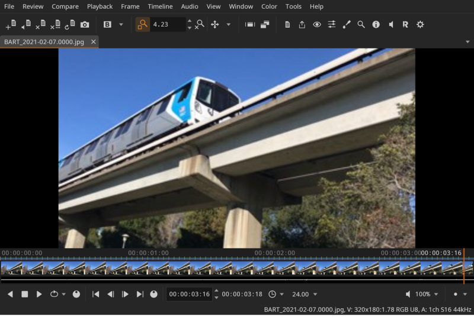

# DJV

DJV is an open source application for media playback and review. It plays back high-resolution image sequences and movies in real time, with audio, A/B comparison, color management, and more.

Features include:

- High-resolution and high bit-depth image support
- A/B comparison with wipe, overlay, difference, and tile modes
- Timeline support with OpenTimelineIO, including bundles and proxy/full resolution switching with media references
- Color management with OpenColorIO
- Multi-track audio with variable-speed and reverse playback
- Export images, image sequences, and movies with audio
- Command line automation
- Experimental USD support when built from source
- Available for Linux, macOS, and Windows

Use the navigation on the left to browse the documentation. Every menu item and its keys are listed in the [Actions reference](actions.html).

The pages are written in Markdown, and most can be read that way: the same name with `.md` in place of `.html`. [llms.txt](llms.txt) lists them for AI agents and other tools.
