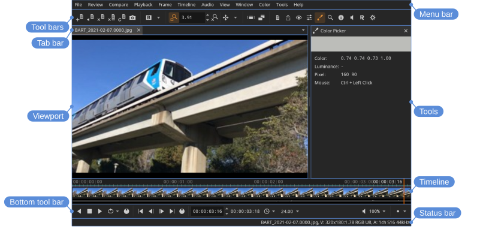

# Main window

The main window is a frame around the view: the menus and tool bars at the top, the timeline and the playback controls under the view, a panel for the tools at the side, and the status bar at the bottom. Each part has a page of its own; this one is about the frame and how to arrange it.

A short tour of the window is shown on the first start, and again from **Help > Tour**.

## The parts

- **Tool bars** — files, compare, window, view, and the tools. When the window is too narrow for them all, buttons move into the **»** menu at the end of the row one at a time, from the right.
- **Tab bar** — the open files; see [Files](files.html).
- **View** — the picture; see [View](view.html).
- **Timeline** — the frames of the current file; see [Timeline](timeline.html).
- **Bottom tool bar** — playback, frame, and audio controls; see [Playback and frame control](playback.html).
- **Tools** — the panel with the current tool, for example the color picker or the magnifier; see [Tools](tools.html).
- **Status bar** — warnings, errors, information, and status indicators. Errors are also shown briefly over the image, so one is not missed while looking at the picture; warnings stay in the status bar. Clicking the status indicator shows the options, with those in use highlighted; click one to show its controls.

## Showing and hiding the parts

Each part can be shown or hidden from the **Window** menu: **Window > File Tool Bar**, **Window > Compare Tool Bar**, **Window > View Tool Bar**, **Window > Window Tool Bar**, **Window > Tools Tool Bar**, **Window > Tab Bar**, **Window > Timeline**, **Window > Bottom Tool Bar**, **Window > Status Tool Bar**, and **Window > Tools** for the tools panel. Hiding parts leaves more room for the view, and the choice is kept between runs.

**Window > Resize** sets the window to one of a few common sizes.

Locations: **Window** menu

## Full screen

**Window > Full Screen** (<kbd>U</kbd>) fills the screen with the window, keeping its parts.

Locations: **Window** menu, **Window** tool bar

## Presentation mode

**Window > Presentation** (<kbd>Ctrl+P</kbd>) fills the screen and hides the user interface and HUD to show only the view.

Locations: **Window** menu, **Window** tool bar

## Float on top

**Window > Float On Top** keeps the window above other applications, so a small reference view stays visible while working in something else.

Locations: **Window** menu

## Secondary window

**Window > Secondary** (<kbd>Y</kbd>) opens a secondary window that mirrors the view, to put on a separate monitor: useful for client review on a calibrated display.

Locations: **Window** menu, **Window** tool bar

## Help

- **Help > Tour** — the tour of the window, the same one shown on the first start.
- **Help > Documentation** — these pages, in a web browser. They are installed with the application, so they describe the version that is running; in a build that was not installed the item is unavailable.
- **Help > Get DJV Studio** — the web site for DJV Studio, the commercial version of DJV. DJV Studio itself does not have this item.
- **Help > About** — the version, when it was built, and the copyright, with **Legal Notices** for the licenses of the libraries DJV uses.
- **Help > System Information** — the version and commit, the paths of the settings and log files, the operating system and hardware, the graphics device and driver, and the versions of the libraries and plugins, with a **Copy** button: what to include when reporting a problem.

Locations: **Help** menu
