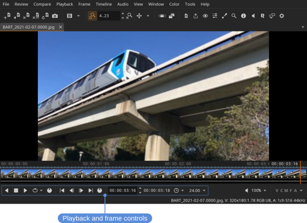
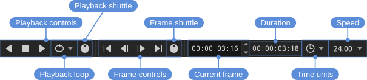

# Playback and frame control

- Playback shuttle — click and drag to vary playback speed
- Frame shuttle — click and drag to scrub the current frame
- Time units (e.g., frames or timecode)

## Time units

The clock button in the playback controls chooses how times are shown: **Frames**, **Seconds**, or **Timecode**. Times are the media's own by default, the frame number or timecode the file gives the first frame, so a movie whose timecode starts at an hour starts at 01:00:00:00.

**Start at Zero**, under the units in the same menu, counts from the start instead: the first frame is 0, 0.00 seconds, or 00:00:00:00, as most players count. Use it when someone says "at 20 seconds" from a player like that. It applies to the frame counter, the timeline, the markers, and what is typed in, and not to durations. It is remembered, and also in the **Time** section of the **Settings** tool.

## Playback controls

**Playback > Forward** (<kbd>L</kbd>), **Playback > Reverse** (<kbd>J</kbd>), and **Playback > Stop** (<kbd>K</kbd>). **Playback > Toggle Playback** (<kbd>Space</kbd>) stops if playing, and otherwise plays in the direction last played.

Locations: **Playback** menu, **Playback** controls

## Speed multiplier

You can temporarily speed up playback by clicking the forward (or reverse) button repeatedly: each click doubles the playback speed. Clicking the opposite direction slows it back down.

For continuous control, click and drag the playback shuttle: dragging in the playback direction speeds up, dragging the opposite way slows down, and releasing returns to normal speed.

## Playback speed

Playback runs at the file's own frame rate. To play at a different rate, click the speed value in the playback controls and choose from the presets; the **Default** entry returns to the file's rate. The HUD's **Time** item shows the rate actually being achieved alongside the requested one.

## Frame navigation

Step through frames or jump to the start or end from the **Frame** menu and the frame controls. Stepping can move by one, ten, or a hundred frames at a time.

Locations: **Frame** menu, frame controls

Shortcuts:

- **Frame > Go To Start** / **Frame > Go To End** — <kbd>Home</kbd> / <kbd>End</kbd>
- **Frame > Previous Frame** / **Frame > Next Frame** — <kbd>Left</kbd> / <kbd>Right</kbd>
- **Frame > Previous Frame X10** / **Frame > Next Frame X10** — <kbd>Shift+Left</kbd> / <kbd>Shift+Right</kbd>
- **Frame > Previous Frame X100** / **Frame > Next Frame X100** — <kbd>Ctrl+Left</kbd> / <kbd>Ctrl+Right</kbd>
- **Frame > Focus Current Frame**, scrolling the timeline to the playhead — <kbd>Ctrl+F</kbd>

## Loop modes

Playback can loop in three ways, set from the **Playback** menu or the loop button in the playback controls:

- **Playback > Playback Loop** — Repeat continuously.
- **Playback > Playback Once** — Play through once and stop.
- **Playback > Playback Ping-Pong** — Play forward to the end, then reverse, and repeat.

Locations: **Playback** menu, playback controls

## Play every frame

Media that can't be read fast enough plays in real time by skipping the frames that aren't ready in time. **Playback > Play Every Frame** waits for each frame instead, so every frame is shown and playback runs slower. The audio is silent while it is on.

The setting is kept between sessions, and it is also in the Settings tool's **Playback** section.

Locations: **Playback** menu, **Settings** tool

## Jumping

You can jump backward or forward by one or ten seconds.

Locations: **Playback** menu

Shortcuts:

- **Playback > Jump Back 1s** — <kbd>Shift+J</kbd>
- **Playback > Jump Back 10s** — <kbd>Ctrl+J</kbd>
- **Playback > Jump Forward 1s** — <kbd>Shift+L</kbd>
- **Playback > Jump Forward 10s** — <kbd>Ctrl+L</kbd>

A second is a second of timecode: 24 frames at 23.976, 30 at 29.97. A jump past the in or out point stops there, or, playing in a loop, goes to the frame the loop comes back to.

## In and out points

In and out points limit playback to a section of the timeline. **Playback > Set In Point** (<kbd>I</kbd>) and **Playback > Set Out Point** (<kbd>O</kbd>) set them at the current frame; **Playback > Reset In Point** (<kbd>Shift+I</kbd>) and **Playback > Reset Out Point** (<kbd>Shift+O</kbd>) put them back at the start and end.

Locations: **Playback** menu, **Playback** controls

## Dropped frames

If playback isn't keeping up, the HUD shows the number of dropped frames in real time. To see every frame instead, turn on [Play every frame](#play-every-frame).

Locations: **View** menu
