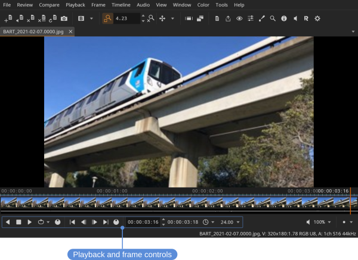
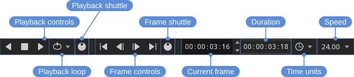

# Playback and frame control

- Playback shuttle — click and drag to vary playback speed
- Frame shuttle — click and drag to scrub the current frame
- Time units (e.g., frames or timecode)

## Playback controls

Start, reverse, and stop playback from the **Playback** menu or the playback controls.

Locations: **Playback** menu, **Playback** controls

Shortcuts:

- Forward — <kbd>L</kbd>
- Reverse — <kbd>J</kbd>
- Stop — <kbd>K</kbd>
- Toggle playback — <kbd>Space</kbd>

## Speed multiplier

You can temporarily speed up playback by clicking the forward (or reverse) button repeatedly: each click doubles the playback speed. Clicking the opposite direction slows it back down.

For continuous control, click and drag the playback shuttle: dragging in the playback direction speeds up, dragging the opposite way slows down, and releasing returns to normal speed.

## Playback speed

Playback runs at the file's own frame rate. To play at a different rate, click the speed value in the playback controls and choose from the presets; the **Default** entry returns to the file's rate. The HUD's **Time** item shows the rate actually being achieved alongside the requested one.

## Frame navigation

Step through frames or jump to the start or end from the **Frame** menu and the frame controls. Stepping can move by one, ten, or a hundred frames at a time.

Locations: **Frame** menu, frame controls

Shortcuts:

- **Frame > Go To Start** / **Frame > Go To End** — <kbd>Home</kbd> / <kbd>End</kbd>
- **Frame > Previous Frame** / **Frame > Next Frame** — <kbd>Left</kbd> / <kbd>Right</kbd>
- **Frame > Previous Frame X10** / **Frame > Next Frame X10** — <kbd>Shift+Left</kbd> / <kbd>Shift+Right</kbd>
- **Frame > Previous Frame X100** / **Frame > Next Frame X100** — <kbd>Ctrl+Left</kbd> / <kbd>Ctrl+Right</kbd>
- **Frame > Focus Current Frame**, scrolling the timeline to the playhead — <kbd>Ctrl+F</kbd>

## Loop modes

Playback can loop in three ways, set from the **Playback** menu or the loop button in the playback controls:

- **Playback > Playback Loop** — Repeat continuously.
- **Playback > Playback Once** — Play through once and stop.
- **Playback > Playback Ping-Pong** — Play forward to the end, then reverse, and repeat.

Locations: **Playback** menu, playback controls

## Jumping

You can jump backward or forward by one or ten seconds.

Locations: **Playback** menu

Shortcuts:

- **Playback > Jump Back 1s** — <kbd>Shift+J</kbd>
- **Playback > Jump Back 10s** — <kbd>Ctrl+J</kbd>
- **Playback > Jump Forward 1s** — <kbd>Shift+L</kbd>
- **Playback > Jump Forward 10s** — <kbd>Ctrl+L</kbd>

A second is a second of timecode: 24 frames at 23.976, 30 at 29.97. A jump past the in or out point stops there, or, playing in a loop, goes to the frame the loop comes back to.

## In and out points

In and out points can be set to limit playback to a section of the timeline.

Locations: **Playback** menu, **Playback** controls

Shortcuts:

- Set in point — <kbd>I</kbd>
- Reset in point — <kbd>Shift+I</kbd>
- Set out point — <kbd>O</kbd>
- Reset out point — <kbd>Shift+O</kbd>

## Dropped frames

If playback isn't keeping up, the HUD shows the number of dropped frames in real time.

Locations: **View** menu
