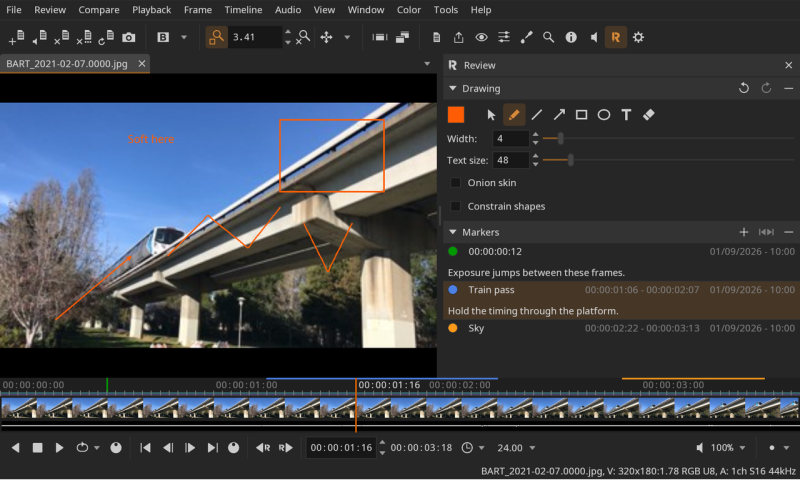
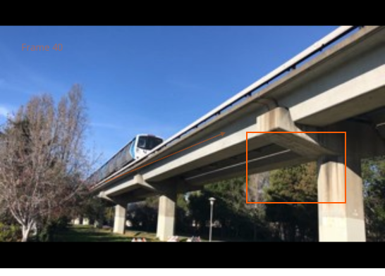

# Review



A *review* is a saved session. Instead of re-opening each file and rebuilding a comparison by hand, you can save the whole setup to a `.djvr` file and reopen it later in one step. A review stores:

- The open files, including any separate audio, the active layer, and each file's speed, current frame, and in/out range.
- The active tab (the **A** file) and the comparison setup: mode, **B** files, wipe, overlay, and the relative/absolute time mode.
- The viewport state: framing, pan, and zoom.
- Color and display state: OCIO, LUT, display, background, foreground, aspect ratio, and HUD.
- The interface: the open tool panels.
- The feedback: markers and drawings.

**Review > Save** (<kbd>Ctrl/Cmd+Alt+S</kbd>) and **Review > Save As (.djvr)** write the session to a review; **Review > Open (.djvr)** (<kbd>Ctrl/Cmd+Alt+O</kbd>) opens one, and **Review > Recent** lists the last few. Opening a review replaces the current session. File paths are stored relative to the `.djvr` when possible, so a review stays valid when moved together with its media; any files that cannot be found are reported in the **Messages** tool.

A review written by a newer DJV than the one you are running is refused, with the reason given in the **Messages** tool, rather than opened in part. Anything else in a review that this version does not understand is left alone: it is kept as it stands when you save, so passing a session between different versions of DJV does not quietly strip it. The document itself is described in [Review file format](review-format.html).

The window title shows the open review's name, with a trailing `*` while it has unsaved changes. **Review > Close** closes the review and returns DJV to its empty startup state; if there are unsaved changes it prompts to save first, as does quitting the application. Closing the last open file does the same, since a review with no files has nothing left to be about; the files stay in **Recent** either way.

While a saved review has unsaved changes, DJV keeps a periodic autosave backup. If the application does not exit cleanly, the next launch offers to recover those changes.

Locations: **Review** menu, **Review** tool

## Building a review: make "A" the primary source

A review can hold any number of files, but **the "A" file is always the master**. Set it to the source the review is *about* — the shot being reviewed — and use the "B" files for what you compare it against.

This is not a stylistic preference: "A" drives playback and timing. The player is built from "A", so its duration, frame rate and audio govern the session; the timeline shows "A"; comparison times are resolved relative to it; and **Fit to A** scales the other sources to match it. A review whose "A" is a reference still plays, but every timing decision then follows the wrong source.

How many "B" files you may add depends on the comparison mode:

| Mode | "B" files |
|---|---|
| A, B, Wipe, Overlay, Difference, Horizontal, Vertical | one |
| Tile | any number |

Selecting a second "B" in a single-buffer mode replaces the first, and switching from **Tile** to any other mode keeps only one "B". This is by design, and it is why reviews are saved with the mode: reopening a tiled review with four sources restores all of them, while the single-buffer modes restore one. In every mode "A" is restored exactly as it was saved.

The recommended way to build a review:

1. Open the primary source first, so it becomes "A".
2. Open the sources to compare against, and mark them as "B".
3. Choose the comparison mode — **Tile** if you need more than two sources.
4. Save the review.

Locations: **Review** menu

Shortcuts:

- Open review: <kbd>Ctrl+Alt+O</kbd>
- Save review: <kbd>Ctrl+Alt+S</kbd>

Reviews can also be opened from the command line:

```
djv session.djvr
```

Personal preferences — keyboard shortcuts, style, cache size, and the audio device — are deliberately **not** stored in a review, so opening one received from someone else does not reconfigure your installation.

## Drawing

The **Drawing** section of the **Review** tool draws on the current frame of a source. Selecting a tool turns drawing on, and the left mouse button draws instead of shuttling frames; clicking the active tool again turns it off. The tools are the pen, for freehand ink; a line; an arrow, with its head where the drag ends; a rectangle and an ellipse, dragged between two corners; text, which is typed in place; and the eraser, which removes whole strokes it touches. The tools are also in the **Review** menu: **Review > Pen**, **Review > Line**, **Review > Arrow**, **Review > Rectangle**, **Review > Ellipse**, **Review > Text**, **Review > Eraser**, and **Review > Select**, below. Holding <kbd>Shift</kbd> while dragging holds a line or an arrow to a multiple of forty-five degrees, a rectangle square and an ellipse round; **Review > Square and Straight Shapes** does the same without a key, for a touch screen.

On a touch screen a finger draws from where it lands, and a second finger still pans and zooms the view: the stroke the first finger started is dropped, and what the eraser took is put back. Handles, strokes to select and the eraser are easier to reach with a finger than with a pointer, since a fingertip covers more than it hits.

Text is written where it is clicked: type, and <kbd>Return</kbd> keeps it, <kbd>Escape</kbd> lets it go. Clicking elsewhere keeps what was typed. While text is being typed the keys are its own, shortcuts included.

The select tool picks a stroke: click it, and drag to move it. A line, an arrow, a rectangle or an ellipse shows a handle at each of its two points, and dragging a handle moves that point, with <kbd>Shift</kbd> holding the shape as it does when drawing. While it is selected the color and the sizes change it rather than the next stroke, <kbd>Delete</kbd> removes it, and a double click or <kbd>Return</kbd> opens text for writing again. Clicking away from any stroke, changing frame, or picking another tool lets the selection go.


The color, the width and the text size apply to the next stroke, and to the stroke selected; the width and the text size are pixels on an HD picture, and scale with the picture drawn on, so a stroke looks the same on a proxy, on HD and on 8K, and keeps its weight whatever the zoom. **Review > Undo Drawing** (<kbd>Ctrl/Cmd+Z</kbd>) and **Review > Redo Drawing** (<kbd>Ctrl/Cmd+Shift+Z</kbd>) cover every stroke, and **Review > Clear Drawing** removes every stroke on the frame, the "B" strokes of a compared frame with it.

A drawing belongs to the frame it was made on. **Review > Onion Skin** shows the drawings on the frames before and after as well, faded, so a note about motion is drawn against where the last one was.



The drawings are written into an export with **Burn in drawings** in the **Export** tool, on the frames they are on and at the size the export is rendered at. The author they are signed with is the **Author** in the settings, or the user name of the account where that is empty.

Locations: **Review** menu, **Review** tool

## Markers

Feedback is written as *markers*: one list in the **Review** tool, each anchored to a frame or a span of frames, with a color, and text if it wants words. **Review > Add Marker**, or the add button, makes a marker on the current frame and opens its text for writing in place; **Review > Add Range**, or the in/out button, makes one for the timeline in/out points. **Review > Previous Marker** and **Review > Next Marker** (<kbd>Alt+Left</kbd> / <kbd>Alt+Right</kbd>) go from one to the next. A marker needs no text — a bare marker is a flag. Clicking a marker goes to its frames, a span narrowing the timeline to itself on the way; double clicking it edits its text. The arrow keys browse the list the same way, <kbd>Return</kbd> edits the current marker, and <kbd>Delete</kbd> removes it.

The markers draw on the timeline in their colors: a span as a band along the top of the ruler, a single frame as a tick.

Locations: **Review** menu, **Review** tool

## Import and export

Markers are standard OpenTimelineIO markers. **Review > Import** opens a `.otio` timeline as a review: it becomes the review's first file, and its markers — wherever they sit, on the stack, the tracks, or the clips — are copied into the feedback. **Review > Export Markers (.otio)** writes the review's markers into a `.otio`: a copy of the reviewed timeline when there is one, and a timeline with one clip referencing the media otherwise, with the markers at the timeline level and the text in each marker's comment. The file being imported is never modified.

Markers and drawings record who made them, the **Author** in the settings or the account name, so a session that has been passed around stays readable.

Locations: **Review** menu
