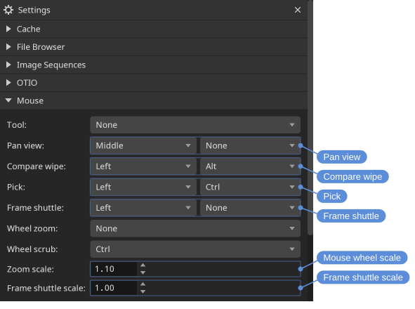
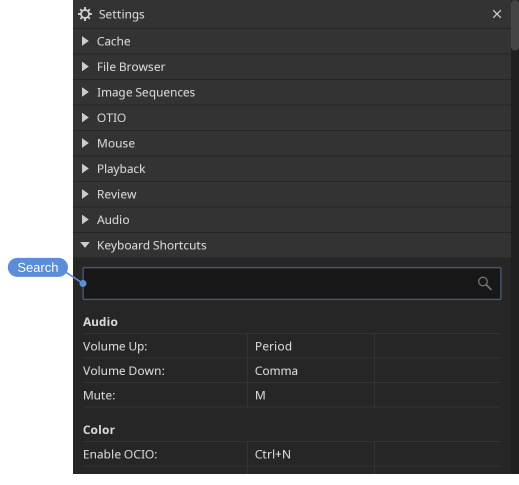

# Settings

Locations: **Tools** menu, **Tools** toolbar

Shortcut: <kbd>F10</kbd>

Settings are stored as a JSON file in the application support directory: **~/Library/Application Support/DJV** on macOS, **%APPDATA%\DJV** on Windows, **~/.config/DJV** on Linux. The path is shown in **Help > System Information**.

The **Settings** tool is divided into collapsible sections:

- **Cache** — Memory cache sizes for video, audio, and read-behind (see [Files](files.html#memory-cache)).
- **File Browser** — Whether to use the native or built-in file browser, and whether the built-in one opens in a window of its own (see [Files](files.html#the-built-in-file-browser)).
- **Image Sequences** — How audio is paired with image sequences, and what happens where a sequence is missing frames (see [File formats](formats.html#partial-image-sequences)).
- **OTIO** — How the spatial coordinates in OTIO files are used to size and position images, and whether to enable workarounds for timelines that do not conform exactly to specification (see [File formats](formats.html#otio-spatial-coordinates)).
- **Mouse** — Mouse button bindings and scaling (see below).
- **Playback** — Options such as whether playback starts automatically when a file is opened.
- **Review** — The author the markers and drawings are signed with; empty for the user name of the account (see [Review](reviews.html)).
- **Audio** — The size of the buffer the audio device is given. Increase this if the audio breaks up during playback.
- **Keyboard Shortcuts** — All keyboard shortcuts (see below).
- **Style** — Interface colors, scale, and whether tooltips are shown (see below). **Auto** follows the display; a chosen scale is kept.
- **Graphics** — What the windows are drawn with: **OpenGL**, or the newer renderer, which is Metal on macOS and Vulkan on Linux and Windows and is what HDR needs. It is experimental; where it cannot draw, OpenGL does. The setting takes effect the next time DJV is started, and the section also says what is drawing now. Starting with `-renderer OpenGL` draws with OpenGL whatever is set. On macOS, with the newer renderer, frames decoded by the hardware are drawn from the decoder's own buffer rather than copied.
- **Time** — Default time units (frames or timecode).
- **FFmpeg** — Built-in FFmpeg decoding options, and where to find the external FFmpeg command, used for what the packaged FFmpeg cannot decode (see [File formats](formats.html#ffmpeg)) and for the movie export presets marked *ffmpeg command* (see [Export](export.html)).
- **USD** — Options for the experimental USD renderer (see [File formats](formats.html#usd)).

Use the button at the bottom of the tool to save the settings manually.

## Mouse

The **Mouse** section maps mouse buttons (and optional modifier keys) to different actions.

**Tool** chooses what the plain left button, or a finger on a touch screen, does: pan, compare wipe, pick, or frame shuttle. With a tool set, an action bound to the plain left button gives it up and the other bindings stay as they are, so the modifier keys keep working beside the tool; **None** leaves the bindings as set. The tool is also in the **View** menu and the view tool bar, where one button turns the last tool chosen on and off and the arrow beside it chooses another. A tool and a [drawing](reviews.html) tool take turns: choosing one turns the other off, so a drag never draws and pans at once.

## Keyboard shortcuts

Each action can have a primary and a secondary shortcut, in the two columns of the table. To set one, click it in the table and press the new key combination; to remove it, click it and then the clear button beside it. A shortcut is shown in red if it conflicts with another. The arrow keys move between the shortcuts and <kbd>Return</kbd> edits the current one; <kbd>Return</kbd> again, or <kbd>Tab</kbd>, leaves it unchanged. The search box helps find an action by name.

> [!NOTE]
> On macOS some shortcuts use the **Command** key instead of **Ctrl**.

## Fonts

The interface is drawn with the fonts DJV ships; there is nothing to set. A pan-CJK font is included as a fallback, so Chinese, Japanese, and Korean file names are rendered without any setting up.
