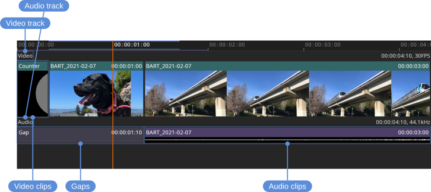

# Timeline

The timeline is the strip under the view: the frames of the current file, where the current frame is, the in and out points, what is in the cache, and the markers. Clicking or dragging in it changes the current frame.

The current frame is the red vertical line. The in/out range is represented by the blue line at the top of the timeline. The cache is represented by the green and purple lines. Markers, from a review or from an OTIO file, are drawn at their frames; see [Markers](reviews.html#markers).

## Moving around

- **Change the current frame** — Left mouse button, clicking or dragging
- **Zoom** — Mouse wheel, or the <kbd>-</kbd> and <kbd>=</kbd> keys
- **Frame the whole timeline** — <kbd>Backspace</kbd>, or **Timeline > Frame View**
- **Pan** — Middle mouse button

From a script, `Timeline/Zoom` sets the zoom in pixels per second, e.g., `-command 'Timeline/Zoom { "value": 100 }'` (see [Automation](automation.html)).

**Timeline > Auto Scroll** keeps the current frame in sight while playing, scrolling the timeline as it goes. **Timeline > Scroll Bars** shows scroll bars for a zoomed timeline.

Locations: **Timeline** menu

## Scrubbing

Scrubbing while playing pauses playback for as long as the mouse button is held, so the picture follows the pointer, and playback resumes from where the drag ends. **Timeline > Stop Playback When Scrubbing** stops playback instead, so that it stays stopped after the drag.

Resting the cursor on the timeline shows a preview of the frame under it, drawn the way the view would show it, with the frame's time. **Timeline > Hover Preview** turns it off. The preview is shown while playback is stopped.

Locations: **Timeline** menu

## Tracks and media

By default, the timeline is minimized and shows only the first video and audio track. **Timeline > Minimize** turns that off to show every track.

The video thumbnails and audio waveforms can be shown and sized independently: **Timeline > Video Thumbnails**, **Timeline > Audio Waveforms**, and their sizes under **Timeline > Video Thumbnail Size** and **Timeline > Audio Waveform Size**. **Timeline > Track Media** (<kbd>C</kbd>) turns both on or off at once. Turning them off saves vertical space and improves performance; with both off, the timeline is a compact strip with just the current frame, in/out range, and cache.

Locations: **Timeline** menu

## Detecting cuts

Review material is often a whole edit flattened into one movie or one image sequence, with no clips to step between. **Timeline > Detect Cuts** finds the cuts in the current file from its pictures and adds a marker named "Cut" at each. **Review > Previous Marker** and **Review > Next Marker** (<kbd>Alt+Left</kbd> / <kbd>Alt+Right</kbd>) then step from cut to cut, and the markers are saved with the review like any others; see [Markers](reviews.html#markers).

It reads every frame in the in/out range, so narrowing the range first does one part of a long movie on its own. The frames are read separately from playback, which carries on, with a progress dialog to cancel it from. A frame that has a marker already is left alone, so running it again adds only cuts not marked before. A cut it got wrong is deleted like any marker, and one it missed is added with **Review > Add Marker**.

It finds hard cuts: each frame is compared with the one before it, and a cut is a frame that is very different, or much more different than the frames around it. A dissolve is not found, and strobing or flashes can add a cut. On a 17 minute 4K film it found 191 of the edit's 196 cuts, with 6 that were not cuts, in about three minutes.

From a script, `-command 'Timeline/DetectCuts'` (see [Automation](automation.html)); from Python, `tl.detectCuts()` in the tlrender module (see [Python](python.html)).

Locations: **Timeline** menu

## Comparing timelines

**Timeline > Compare Timelines** shows the timeline of each file being compared under the current file's, which is useful when the files are two cuts of the same edit. It is off by default. See [A/B comparison](compare.html).

Locations: **Timeline** menu
