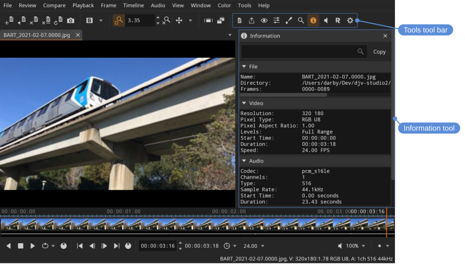
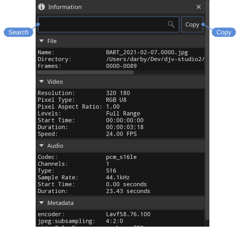
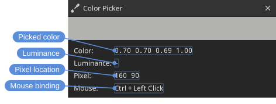
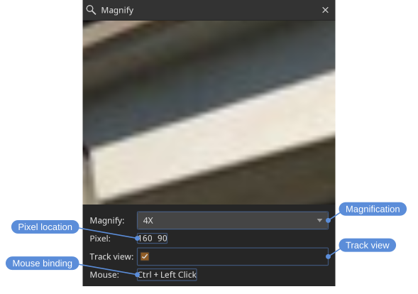

# Tools

DJV's features are organized into *tools*. Each tool opens in a panel on the right side of the main window, and only one tool is shown at a time. Tools can be opened from the **Tools** menu or the **Tools** tool bar, and each has a default keyboard shortcut.

| Tool | Shortcut | Purpose |
|---|---|---|
| **Files** | <kbd>F1</kbd> | Manage open files, layers, and comparison |
| **Export** | <kbd>F2</kbd> | Write out images, image sequences, and movies |
| **View** | <kbd>F3</kbd> | View options — grid, background, outline, and more |
| **Color** | <kbd>F4</kbd> | OpenColorIO, LUTs, and color adjustments |
| **Color Picker** | <kbd>F5</kbd> | Sample pixel color values |
| **Magnify** | <kbd>F6</kbd> | Magnify a region of the view |
| **Information** | <kbd>F7</kbd> | View file metadata |
| **Audio** | <kbd>F8</kbd> | Audio output, volume, and sync |
| **Review** | <kbd>F9</kbd> | Markers and drawn annotations — see [Review](reviews.html) |
| **Settings** | <kbd>F10</kbd> | Application settings |
| **Messages** | <kbd>F11</kbd> | Application messages |
| **System Log** | <kbd>F12</kbd> | Low-level system log |

The **Files**, **View**, **Color**, **Export**, **Audio**, and **Settings** tools each have their own page. The remaining tools are described below.

## Information

The **Information** tool displays the metadata of the current file: the file name and directory, video and audio format details (codec, resolution, pixel type, sample rate, and so on), and any tags embedded in the file, such as camera make and model or creation date.

Locations: **Tools** menu, **Tools** toolbar

Shortcut: <kbd>F7</kbd>

Use the search box to filter the list to matching entries: each word of the search is matched on its own against the names and values, so **name duration** shows both rows. The **Copy** button copies the information, filtered the same way, to the clipboard.

## Color picker

The **Color picker** tool samples the color of a pixel in the view.

Locations: **Tools** menu, **Tools** toolbar

Shortcut: <kbd>F5</kbd>

Pick a pixel with **Ctrl** + left mouse button (the binding can be changed in the **Mouse** section of the **Settings** tool). The tool shows a color swatch, the sampled RGBA values, the pixel position, and the current mouse binding. **Luminance** is the luminance the color stands for, in nits, where that is known: for a picture that is PQ encoded, and for any picture in an HDR window. Otherwise it is a dash.

## Magnify

The **Magnify** tool shows a magnified view of the area around the picked pixel — handy for inspecting fine detail.

Locations: **Tools** menu, **Tools** toolbar

Shortcut: <kbd>F6</kbd>

Pick a pixel with **Ctrl** + left mouse button. The magnification level can be set from **2X** up to **128X**.

> [!TIP]
> To inspect exact pixel boundaries, combine the magnifier with the grid: set **Magnify** to **Nearest** in the **View** tool, enable the grid, and set the grid size to `1` (see [View](view.html)).

## Messages and system log

The **Messages** tool shows application messages such as warnings and errors, while the **System Log** tool shows a more detailed, low-level log. Both are useful when reporting a problem (see [Troubleshooting](troubleshooting.html)).

Locations: **Tools** menu, **Tools** toolbar

Shortcuts:

- Messages: <kbd>F11</kbd>
- System Log: <kbd>F12</kbd>

Each tool can **Copy** its contents to the clipboard or **Clear** them, and has an **Auto-scroll** option to keep the newest entries in view.
