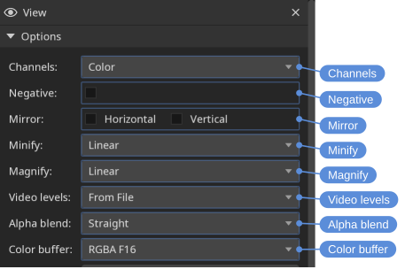
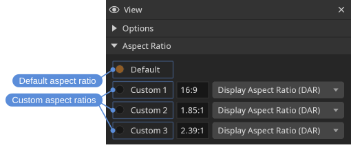
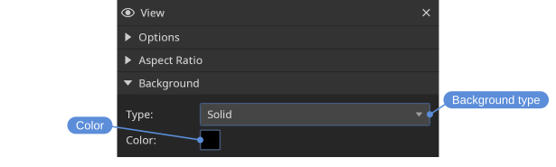
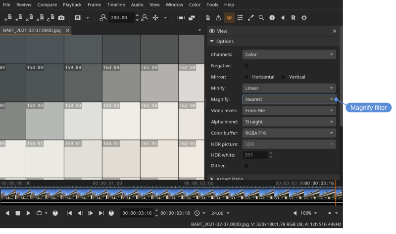
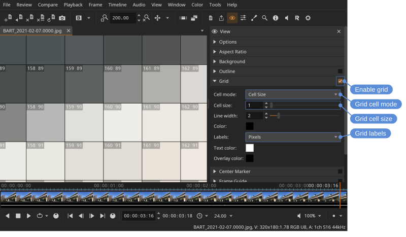
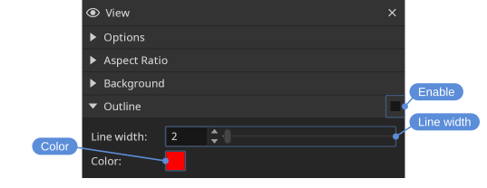
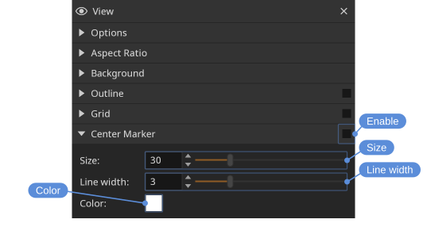
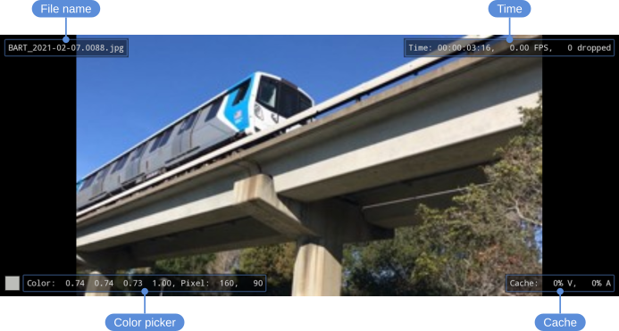
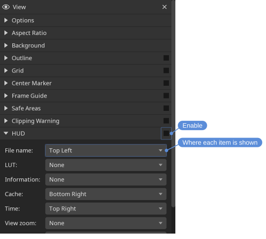

# View

The view displays the current file. You can pan, zoom, or *frame* the view so the image fills the available space.

Default view controls:

- **Pan** — Middle mouse button
- **Zoom** — Mouse wheel, or the **-** and **=** keys
- **Frame view** (fit image to view) — **Backspace**
- **Wipe** (in compare mode) — **Alt** + left mouse button
- **Color picker** — **Ctrl** + left mouse button
- **Frame shuttle** (scrub frames by dragging) — Left mouse button
- **Scrub frames** — **Ctrl** + mouse wheel

View controls can be remapped in the **Mouse** section of the **Settings** tool.

## Framing and zoom

The view can be framed (fit to the view), reset to 1:1, or zoomed in and out from the **View** menu and the zoom control on the **View** tool bar. A double click, or a double tap on a touch screen, frames it too.

- **View > Frame** — <kbd>Backspace</kbd>
- **View > Zoom Reset**, 1:1 — <kbd>0</kbd>
- **View > Zoom In** / **View > Zoom Out** — <kbd>=</kbd> / <kbd>-</kbd>
- **View > Center** — <kbd>\</kbd>

Locations: **View** menu, **View** tool bar, **View** tool

## Mouse tool

What the plain left mouse button, or a finger on a touch screen, does in the view: nothing of its own, or one of the tools under **View > Mouse Tool**:

- **View > Mouse Tool > Pan View** — Drag to move the picture.
- **View > Mouse Tool > Compare Wipe** — Drag to move the wipe between A and B; see [A/B comparison](compare.html).
- **View > Mouse Tool > Pick** — Pick colors, as the **Color Picker** tool does; see [Tools](tools.html).
- **View > Mouse Tool > Frame Shuttle** — Drag left and right to move through the frames.

With a tool chosen, the other actions keep their buttons and keys, so the modifiers still work beside it; the drawing tools take the button while one is in use. The tools are also on the **View** tool bar, and the bindings are in the **Mouse** section of the **Settings** tool; see [Settings](settings.html).

Locations: **View** menu, **View** tool bar, **Settings** tool

## Color channels

Individual color channels can be isolated to inspect them.

Locations: **View** menu, **View** tool

Shortcuts:

- **View > Red Channel** — <kbd>R</kbd>
- **View > Green Channel** — <kbd>G</kbd>
- **View > Blue Channel** — <kbd>B</kbd>
- **View > Alpha Channel** — <kbd>A</kbd>

## Mirror

The image can be mirrored horizontally or vertically.

Locations: **View** menu, **View** tool

Shortcuts:

- **Mirror horizontal** — <kbd>H</kbd>
- **Mirror vertical** — <kbd>V</kbd>

## Options

- **Channels** — Show the color image, or only the red, green, blue, or alpha channel.
- **Negative** — Show the image as a negative.
- **Mirror** — Mirror the image horizontally or vertically.
- **Minify** — Filter used when the image is scaled down (**Nearest**, **Linear** or **High Quality**).
- **Magnify** — Filter used when the image is scaled up (**Nearest**, **Linear** or **High Quality**). Use **Nearest** to see individual pixels without smoothing.
- **Video levels** — How video levels are interpreted: from the file, full range, or legal range.
- **Alpha blend** — How the alpha channel is blended: none, straight, or pre-multiplied.
- **Color buffer** — The view's bit depth. The default, **RGBA F16**, keeps color values above white and below black rather than clamping them, at half the memory of **RGBA F32**; F32 is there for the rare case where half a float is not enough. **RGBA U8** is the fastest and the only one that clamps. Exporting is not affected: it always renders at the highest precision this build has.
- **HDR picture** — Whether the picture is shown as HDR: **SDR**, or **PQ** for a picture that is PQ encoded (see [HDR](#hdr)).
- **HDR white** — The luminance, in nits, that the white of the interface stands for, where the system does not say: on macOS.
- **Dither** — Dither the picture where the window is eight bit, which hides the banding of gradients drawn with more precision (see [Bit depth](#bit-depth)). Only what is shown changes: the color picker, the magnifier and the exports read the picture before it. Off by default.

**High Quality** weighs many more pixels than **Linear**, which reads only four whatever the scale. The difference shows most where the scale is largest — a thumbnail, or the view zoomed well out — where **Linear** misses most of the image and fine detail breaks up into aliasing that crawls during playback.

It costs more than **Linear**, and the two directions cost differently:

- Scaling **down** is bounded, and gets cheaper the further out you zoom, because there are fewer pixels on screen to produce.
- Scaling **up** is the opposite: the cost follows the size of the view, so it is highest on a large display at a high zoom.

If playback drops frames, this is one of the settings to try at **Linear** — along with **Color buffer** — and the HUD's **Time** item reports the frames dropped while you compare them.

## Bit depth

With the newer renderer (**Metal** or **Vulkan**, chosen under **Graphics** in the **Settings** tool) on macOS and Windows, the window is drawn into a sixteen bit float surface whether or not the display is showing HDR. A display with a ten bit panel then shows an SDR picture with more than eight bits: a smooth gradient in a ten or sixteen bit file stays smooth, where an eight bit window shows it as steps. On Linux the float surface is the desktop's HDR one and nothing else, and with OpenGL the window is always eight bit.

**Dither** in the [options](#options) is for the eight bit case. It adds a pattern of less than one code to the picture before it is shown, which breaks the steps up into noise that is hard to see. It is close to the ten bit picture but not the same, so it is off by default and is only worth turning on when banding shows.

## HDR

DJV can show a PQ encoded picture, such as an HDR10 movie, as HDR on a display that is showing HDR. This is experimental: the levels have been looked at on HDR displays and have not yet been measured.

It needs three things:

- The newer renderer. Choose **Metal** or **Vulkan** for **Renderer** in the **Graphics** section of the **Settings** tool, and start DJV again. OpenGL cannot show HDR, and the two options below are disabled with it.
- A display that is showing HDR: turned on in the system's display settings on macOS and Windows, and on Linux in a Wayland session with HDR turned on for the display. An X11 session has no HDR.
- **HDR picture** set to **PQ** in the **View** tool's options.

With OpenColorIO off, the picture's PQ values are shown as they are. With it on, choose a display and view that are PQ, such as **Rec.2100-PQ - Display** with an HDR view, so that what OpenColorIO produces is PQ as well. A picture that OpenColorIO has brought to an SDR display is an SDR picture, and **HDR picture** stays at **SDR** for it.

The interface and SDR pictures are shown at the display's ordinary white, not brighter. **HDR white** is the luminance that white stands for, which decides how bright a PQ picture is beside it. It is used on macOS, where the system does not say what its white is; Windows says, and on Linux it is 203 nits, which is where the desktop puts white for an HDR surface.

The [Color picker](tools.html#color-picker) shows the luminance a pixel stands for, in nits.

Not supported: HLG pictures, and HDR metadata, which is neither read from a file nor written by the export.

## Aspect ratio

The pixel aspect ratio can be left at the file's default or overridden. Up to three custom aspect ratios can be defined.

**Default** uses the aspect ratio the file declares, which de-squeezes an anamorphic movie. Each custom entry has a value and a type:

- **Display Aspect Ratio (DAR)** — The value is the finished shape of the image, so 2.39 shows it at 2.39:1 whatever the file says.
- **Pixel Aspect Ratio (PAR)** — The value is the shape of a pixel, applied to the stored resolution, and the file's own is ignored. On a camera this is the lens squeeze factor.

> [!TIP]
> To see an anamorphic image as it is stored, set a custom entry to **Pixel Aspect Ratio (PAR)** with a value of **1**.

The custom entries start as **View > Aspect Ratio > 16:9 DAR**, **View > Aspect Ratio > 1.85:1 DAR** and **View > Aspect Ratio > 2.39:1 DAR**, the common delivery shapes, and are changed in the **View** tool.

Locations: **View** menu, **View** tool

## Background

The view background color can be customized.

Locations: **View** tool

## Grid

A grid overlay can be shown to identify areas in the view.

Locations: **View** menu, **View** tool

Shortcut: <kbd>Ctrl+G</kbd>

The grid can also help you inspect individual pixels. To do so:

- Set **Magnify** to **Nearest**
- Enable the grid
- Set the grid cell mode to `Cell Size`
- Set the grid size to `1`
- Set the grid labels

## Outline

An outline can be drawn around the image to make transparent regions easier to distinguish from the background.

Locations: **View** tool

## Center marker

A marker can be shown at the center of the view to help with alignment and framing. Its size, line width, and color can be customized.

Locations: **View** menu, **View** tool

## Clipping warning

**Clipping warning** covers pixels outside a range in a warning color: red above the range, magenta below it. **Mode** sets what is compared: **Any Channel** flags a pixel when any of red, green, and blue is outside the range, **All Channels** only when all three are, and **Luminance** compares the brightness of the pixel, with the Rec. 709 weights. The range is checked on the values as they are displayed, after the color management and the other adjustments. The default range of 0 to 1 marks what the display cannot show; set it to 0.063 and 0.922 (16 and 235 out of 255) to mark the video legal range. The color picker reads the pixel under the warning.

Locations: **View** menu, **View** tool

A shortcut can be assigned in the **Settings** tool.

## HUD

The heads-up display (HUD) overlays useful information on top of the view: **View > HUD / Information Display** (<kbd>Ctrl+H</kbd>).

Locations: **View** menu, **View** tool

- **File name** - Name of the current file.
- **Information** - Video (**V**) and audio (**A**) format of the current file.
- **Cache** - Video (**V**) and audio (**A**) cache fill (%)
- **Time** - Current frame, actual playback speed (the rate DJV is achieving, which may differ from the requested rate), number of frames dropped during playback.
- **View zoom** - Current view zoom.
- **Color picker** - Color and position of the picked pixel. Shown as **-** when the pointer is not over an image.
- **Render** - Size the image is rendered at, and the pixel aspect ratio when it is not square. This differs from the file's own resolution when an aspect ratio is applied.

Each item can be placed in any corner of the view, or set to **None** to hide it, so that only what is wanted is shown and items do not crowd each other.

